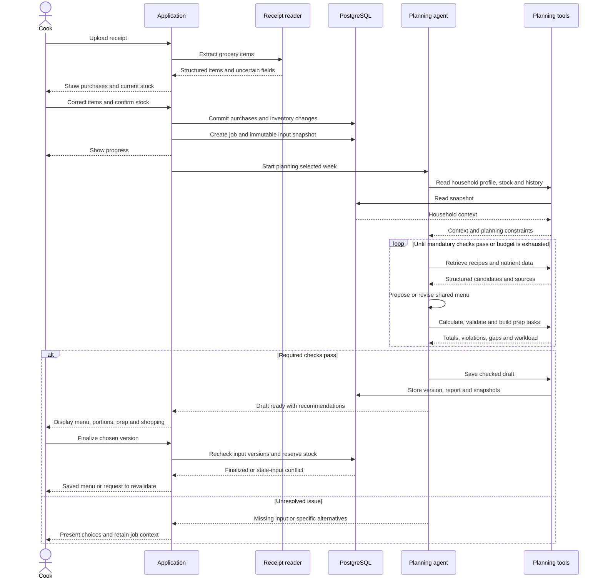
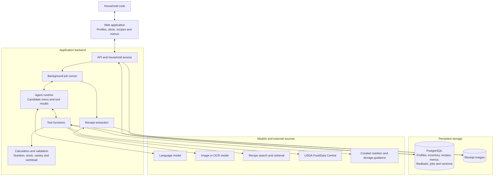
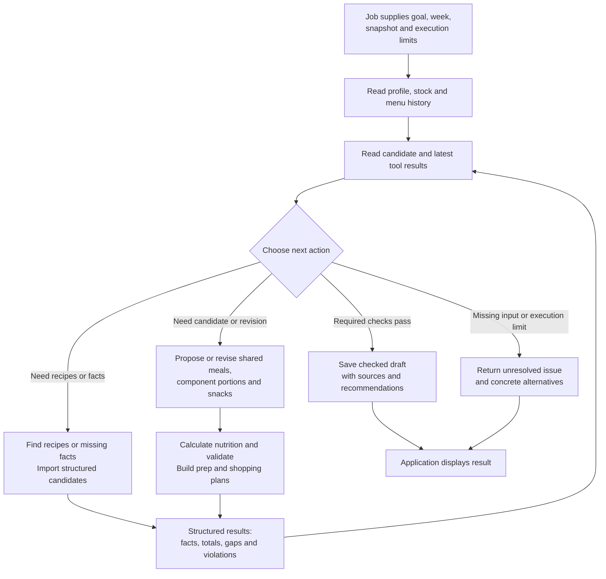
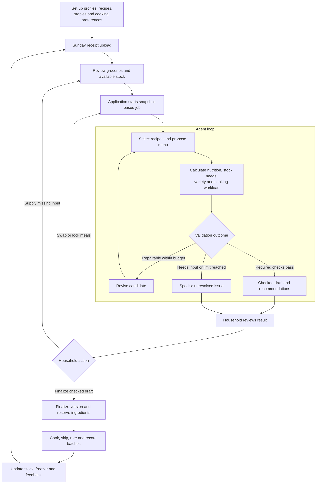

# MenuAgent MVP Implementation Handoff

**Plan version:** 2 
**Recorded:** October 9, 2026 
**Status:** Agreed cooking-preference revision; version 1 remains archived unchanged

MenuAgent is a household meal planning application with one planning agent. After the Sunday grocery receipt is uploaded and its items are reviewed, it produces the following week's breakfast, lunch, dinner, and snack plan. One person cooks shared meals; individual serving amounts and easy additions help accommodate different nutrition needs. The plan includes cooking tasks, targeted extra purchases, freezer suggestions, and nutrition estimates. Recipes and previous menus remain available for reuse and feedback.

The application owns records, job execution, and household interaction. The agent selects recipes and revises candidates through tool calls. Application code calculates quantities and nutrition and checks whether a proposal meets the planning rules.

## Agreed scope and implementation assumptions

| Status | Decision |
| --- | --- |
| Agreed | Cover breakfast, lunch, dinner, and snacks for seven days. |
| Agreed | One main cook prepares shared meals. Individual nutrition needs must not create separate cooked dishes for each person. |
| Agreed | Store member preferences and manually entered daily calorie, protein, carbohydrate, and fat targets. |
| Agreed | Support children through nutritious, age appropriate family meals and serving suggestions. |
| Agreed | Use receipts, fridge, pantry, freezer, and usual staple availability as inputs. |
| Agreed | Store shared cuisines, go-to dishes, categorized recipes, and historical weekly menus. |
| Agreed | Avoid repeated finished meals within a week. Discover new recipes and rotate the existing collection. |
| Agreed | Allow specific extra ingredient recommendations, batch preparation, and freezing portions for future use. |
| Proposed default | Use a responsive web application, PostgreSQL, receipt image storage, and a background job worker. Framework, hosting, and model providers remain open. |
| Proposed default | Start with one household editor. Member nutrition profiles are separate records and do not require separate user accounts. |
| Proposed default | Sunday uploads plan Monday through Sunday in the household's timezone. Allow choosing another week. Receipt review precedes automatic draft generation. |
| Proposed default | Treat adult nutrition targets as goals with visible deviations. Required restrictions and weekly uniqueness remain mandatory. Cooking effort is a household preference; estimated minutes are guidance, not a pass/fail budget. |
| Proposed default | Children default to food variety and balanced meal coverage. Numeric targets are optional and entered by the household when appropriate; the app does not calculate restrictive targets automatically. |

The first release includes web recipe discovery, receipt parsing, batch preparation suggestions, and freezer tracking. They are delivered after the basic planning loop works, rather than being removed from MVP scope.

## Cooking preferences — agreed revision in version 2

Replace daily active cooking and Sunday preparation minute budgets with:

- Usual cooking effort: mostly assembly/reheating, simple cooking, or comfortable with more involved meals.
- Weekly meal-prep preference: none, a small session, or a larger weekly session.
- Usually busier weekdays: prioritize easy recipes on these days, using fewer steps and less hands-on attention. Weekly exceptions will override these defaults when implemented.

New household preferences remain unset until entered. Historical minute values are retained during migration, but are no longer read or enforced. Recipe times are approximate and differ by cook. Do not derive an effort score solely from recipe minutes. Equipment and recipe effort metadata arrive with recipe implementation; feedback can improve future rankings without silently changing saved preferences.

The current UI saves these inputs; sample menu generation does not yet apply them. The future evaluator ranks workload suitability and returns visible recommendations when eligible easy recipes are unavailable. Restrictions, nutrition assessment and within-week dish uniqueness continue to apply.

## Phase 2 — Put and forget recipes

Add a categorized collection of meals requiring little active supervision, including Instant Pot and other supported appliances. Overnight cooking is a separate suitability attribute, not something inferred from a low-effort or appliance tag.

Store supported equipment, required setup and interventions, active/passive time estimates, scheduling information, and source-backed cooking, holding and storage instructions. Recommend an overnight option only when the specific recipe and appliance guidance support that use; otherwise offer a daytime option. These features are deferred to phase 2 and are not part of this household-preference implementation.

## Weekly workflow and outputs

1. Save household profiles, cuisines, cooking-effort and meal-prep preferences, recipes, and staple availability during setup.
2. Upload a receipt. Extract both readable text and structured grocery items, preserving unclear fields for correction.
3. Review purchases and current stock. A receipt is evidence of purchases, not proof of what remains available.
4. Set the week's exceptions, including meals away, attendance, busier days, and meal-prep preferences. Recurring busier weekdays are saved during setup; week-specific overrides remain planned work.
5. Start a planning job from an immutable snapshot of confirmed inputs.
6. Generate and check a shared menu. Use existing recipes and discover additional candidates when variety or ingredient coverage requires them.
7. Present individual serving suggestions, estimated daily nutrition, gaps, cooking tasks, extra shopping, and freezer allocations.
8. Allow swaps and locked meal slots. Replan unlocked slots and recalculate the whole week, including ingredient allocations.
9. Finalize the menu, preserving its recipe and nutrition snapshots. Reserve available ingredients.
10. During the week, record cooked or skipped meals, quantities used when known, freezer batches, and simple ratings.

The weekly result contains five connected outputs: the menu, individual nutrition estimates, the cook's preparation schedule, a targeted shopping list, and a freezer plan. Additional receipts for the same week update stock and offer regeneration of the relevant draft or unlocked meals; they do not silently replace a finalized menu.

## Planning rules

| Rule | Implementation behavior |
| --- | --- |
| Shared meals | Use the same prepared dishes for attending household members. Vary amounts of shared components and ready-to-eat additions. |
| Dietary restrictions | Check every recipe component against household restrictions. Unknown ingredient or restriction information produces a review issue. Conflicts return compatible shared alternatives. |
| Weekly uniqueness | Prevent repeated finished dishes across planned meal slots. Rotate snack combinations; recurring staple ingredients and reused preparation components are allowed. Renamed dishes do not bypass duplicate checks. |
| One cook | Evaluate steps, chopping, hands-on attention, equipment, cleanup and dependencies across all meals. Favor easy recipes on busier days. Use estimated minutes as guidance, not as a mandatory budget; individual cooking times differ. |
| Inventory | Allocate ingredient quantities across the whole week and freezer reservations. Never spend the same tracked stock twice. Clearly distinguish stock on hand from proposed purchases and unquantified staples. |
| Nutrition | Compute estimates from sourced ingredient quantities and member portions. Show target differences and data completeness. Missing values remain unknown rather than becoming zero. |
| Variety over time | Consult recent cooked menus, cuisine, dish family, cooking style, and ratings. Historical repetition is a preference penalty; within-week duplication is a required check. |
| Recipe growth | Import relevant new recipes with source links, structured quantities, and preparation details. Store selected recipe versions and collect feedback. |
| Efficient preparation | Reuse components in different finished dishes. Freeze surplus for future weeks without scheduling the same finished dish repeatedly in the current week. |

Adult targets influence selection and portions across the entire day. Changing the size of a mixed dish preserves its nutrient ratios, so the agent may need another shared recipe or an easy existing snack to improve fit. It should explain remaining gaps rather than create separate cooked meals.

For children, food group variety and appropriate serving suggestions guide the default mode. Planned servings are estimates, not a requirement to finish a plate. This follows the AAP's emphasis on offering appropriate portions and allowing children to respond to appetite. [AAP guidance on portions and appetite](https://www.healthychildren.org/English/healthy-living/nutrition/Pages/Making-Sure-Your-Child-is-Eating-Enough.aspx).

## Sequence diagram

This sequence covers receipt intake, the bounded planning loop, and finalization. A menu with visible nutrition deviations can be a valid draft when its mandatory rules pass.

## Architecture diagram

The backend and tool functions can share one codebase. A worker executes long jobs while the web application displays progress. Model providers, search providers, and deployment products are replaceable adapters.

## Agent behavior diagram

The agent chooses actions from current tool results. Candidate validation remains tied to the exact menu version; revising a menu invalidates its prior check report. Only a currently checked candidate can be saved as a ready draft.

## Application and agent loop

The application records household decisions and actual cooking outcomes. Outcomes feed the following week's inventory and recipe selection. Locked meal slots survive regeneration.

## Suggested data model

Use household identifiers on owned records and store timestamps in UTC with a household timezone for week boundaries. Separate editable current records from immutable plan versions and input snapshots.

| Logical records | Important fields and relationships |
| --- | --- |
| Households and editor access | Timezone, shared cuisines, go-to dishes, equipment, usual cooking effort, weekly meal-prep preference, recurring busy days, shopping limits, variety preferences |
| Member profiles | Household, name, adult or child mode, age group where needed, manually entered targets, restrictions, likes and dislikes |
| Ingredients and nutrient records | Canonical ingredient, aliases, units, preparation state, brand when relevant, nutrient values and units, source identifier, retrieved date |
| Inventory lots and events | Ingredient, location, quantity or confirmed stock status, purchase or preparation date, freezer status, reservations, source event and version |
| Receipts and receipt items | Image reference, duplicate fingerprint, raw text, parsed items, uncertain fields, reviewed values, receipt date, confirmation status |
| Recipes and recipe versions | Source URL, cuisine, meal category, dish family, ingredients and amounts, servings or yield, instructions, active and passive time estimates, effort features (steps, chopping, attention and cleanup), equipment, components and storage references |
| Weekly plans and plan versions | Household, week start, draft or final status, input snapshot, rule settings, validation report, nutrition completeness, immutable recipe snapshots |
| Meal slots and components | Date, meal type, attendance, recipe version, shared component quantities, lock state, provenance |
| Member portions | Meal slot, member, shared component amounts, optional ready-to-eat additions, calculated estimates |
| Cooking outcomes and feedback | Cooked or skipped state, confirmed quantities used, recipe rating, effort feedback (easy, too much work, longer than expected), optional actual cooking time, linked inventory event and freezer batches |
| Planning jobs | Status, attempts, execution limits, input versions, snapshot, candidate version, tool results, error or issue summary, final draft reference |
| Guidance documents | Topic, applicable age groups, publisher, source URL, document version or date, retrieved date, supported rules |

Stock may be quantified or confirmed as an untracked staple. Unknown amounts must remain explicit. Purchase prices are not ingredient weights. Meal preparation consumes raw stock and can create prepared or frozen lots in the same recorded transaction; later meals consume those lots rather than consuming the raw ingredients again.

## Agent tool contracts

All tools receive trusted household and job context from the runtime. Read tools use the job snapshot. Results use structured data with status, issues, provenance, and relevant input versions. Write tools are transactional and accept an idempotency key. Errors distinguish missing input, no match, unavailable service, stale version, and validation failure.

| Tool | Main input | Required result |
| --- | --- | --- |
| `parse_receipt` | Receipt image reference | Raw text, structured items, units, ingredient candidates, uncertain fields; no automatic stock mutation |
| `get_household_profile` | Snapshot context | Members, entered targets, child mode, restrictions, cuisines, cooking and shopping settings |
| `get_inventory` | Snapshot context and optional ingredient filter | Available lots, quantities, stock status, freezer batches, reservations and versions |
| `update_inventory` | Reviewed changes, source event, expected version | Committed events and resulting version; repeated source events have no duplicate effect |
| `get_menu_history` | Date range | Planned and actually cooked dishes, recipe families, cuisine and ratings |
| `search_recipes` | Ingredients, cuisine, meal type, restrictions, effort features, equipment, optional estimated time, source choice | Saved candidates or web candidate URLs, source links and match details |
| `import_recipe` | Source URL | Structured recipe draft, ingredients, quantities, yield, timing, unknown fields and provenance |
| `save_recipe` | Recipe draft and source | Stored version and validation state; incomplete recipes remain drafts |
| `get_reference_guidance` | Topic and applicable age group | Curated passages or rules, sources, dates and applicability |
| `lookup_food_nutrients` | Ingredient, preparation state and brand when relevant | Matched source record, nutrient values and units, alternative matches or unresolved fields |
| `calculate_nutrition` | Menu version and member portions | Recipe, portion and daily estimates, target differences and completeness |
| `validate_menu` | Menu version and calculated results | Mandatory violations, nutrition gaps, duplicate families, stock shortfalls and workload issues |
| `build_prep_plan` | Menu, recipe tasks, stock and cooking settings | Scheduled tasks, shared component batches, equipment dependencies and proposed freezer quantities |
| `build_shopping_list` | Household quantities and available inventory | Missing ingredient amounts, affected meals and distinctions between confirmed needs and unknown quantities |
| `save_weekly_menu` | Checked candidate, report and expected input versions | Saved ready-draft version or stale/invalid result; finalization is an application action |

Profile edits and recording cooking outcomes are ordinary application operations. The agent reads entered targets and records recommendations; it does not silently change profile targets.

## Calculation and execution requirements

Use ingredient amounts and sourced nutrient values to calculate recipe totals, then allocate components to members. Include oils and sauces and preserve the raw or cooked state used by each source. Volume-to-weight conversion requires an ingredient-specific conversion or a reviewed quantity. Record yield assumptions where cooked portions are derived from raw recipe inputs.

USDA FoodData Central exposes food search and food detail endpoints suitable for the nutrient adapter; requests require an API key. Store matched source identifiers and retrieved nutrient records so historical menus remain reproducible. [USDA FoodData Central API guide](https://fdc.nal.usda.gov/api-guide/).

Guidance retrieval is separate from nutrient lookup. Curated age-specific references inform food variety and portion suggestions, while ingredient records supply calculated estimates. Freezing and thawing recommendations should retain authoritative source links and applicable conditions. [USDA freezing and food safety reference](https://www.fsis.usda.gov/food-safety/safe-food-handling-and-preparation/food-safety-basics/freezing-and-food-safety).

The worker follows `queued`, `running`, `needs_input`, `draft_ready`, `failed`, and `cancelled` states. A new revision creates a new candidate and validation report. Finalized menus retain immutable recipe, source, portion, and nutrition snapshots.

Before starting a job, check whether the recipe pool can satisfy required meal coverage and weekly uniqueness. Before saving or finalizing, compare relevant profile and inventory versions with the snapshot; changed inputs require revalidation. Finalization replaces reservations for a prior active plan version without doubling them. Cooking events update stock exactly once and release the matching reservation. Skipped meals release their reservation.

Configure maximum tool calls, candidate revisions, elapsed time, and external fetches per job. Record candidate versions, tool outcomes, sources and issue summaries. Stop when mandatory rules pass or the execution budget is exhausted. On failure, retain a resumable snapshot and return specific remedies, such as correcting a receipt quantity, adding a compatible recipe, or adjusting a cooking-effort preference. Restrictions are never silently relaxed.

Treat nutrition gaps and recent-week repetition as reported preferences. A ready draft may depend on explicitly listed extra purchases within the household's shopping settings. It must distinguish those purchases from stock already available and only reserve existing stock.

## Application screens and operations

| Screen | Required capabilities |
| --- | --- |
| Household | Edit member profiles, manual targets, child mode, shared cuisines, restrictions and cooking settings |
| Groceries and stock | Upload and review receipts; correct ingredient matches and units; edit fridge, pantry, freezer and staple availability |
| Recipes | Search and filter; add or import recipes; review incomplete quantities; categorize and rate |
| This week | See all meal slots, shared recipes, individual portions, nutrition estimates, daily workload, shopping and freezer suggestions; swap, lock and finalize |
| History | View immutable past menus, outcomes and ratings; use a prior menu as a candidate subject to current validation |

The backend needs operations for saving profiles, reviewing receipt items, confirming purchases once, updating stock, starting jobs, reading job status, editing a candidate, finalizing a checked version, and recording a cooked or skipped meal. Keep model and data-provider credentials on the backend and scope records to the authenticated household.

## Build order

| Milestone | Deliverable and completion gate |
| --- | --- |
| 1 Household records | PostgreSQL migrations, editor access, profile forms, shared settings and manual inventory entry. Data persists and remains scoped to the household. |
| 2 Recipes and calculations | Recipe library, normalized ingredients, sourced nutrient matching, member portions and validation. Known fixtures produce reproducible totals and expose missing data. |
| 3 Planning loop | Background worker, input snapshots, agent tool calls, bounded revisions and a complete week from manually entered stock. Required constraints pass and unresolved cases return concrete issues. |
| 4 Receipt and discovery inputs | Editable receipt extraction, duplicate handling, recipe search and imports. Confirmed purchases feed the same planning loop, and new recipes carry source links and structured quantities. |
| 5 Weekly use | Swaps, locks, prep and shopping tasks, freezer batches, finalization, cooking outcomes, ratings and history. Edits recalculate the whole plan and stock updates occur once. |
| 6 MVP verification | End-to-end acceptance scenarios, deployment configuration and integration checks. All agreed MVP capabilities work together. |

The first implementation milestone for the agent is a full week from manually entered stock and saved recipes, with calculation and validation tools. Integrations should feed that same loop once it is working.

## Acceptance criteria

- A reviewed Sunday receipt and confirmed stock produce a complete seven-day plan for all selected household meal slots.
- Household members share prepared dishes. Two adults with different targets receive component portion suggestions without additional individually cooked dishes.
- Children receive the selected age appropriate balanced-food mode; adult calorie targets are not copied into child profiles.
- A finished dish is not scheduled repeatedly within a week, including superficially renamed duplicates. Prepared components can appear in distinct dishes.
- On busier days, favor recipes with fewer steps and less hands-on work while preserving shared dishes, restrictions and weekly variety. Honor the meal-prep preference, including no prep. Time estimates remain labeled guidance; missing effort details remain visible. Proposed shopping remains within household settings.
- Ingredient allocation spans the whole week, including prepared and frozen batches. Stock on hand, proposed purchases and unknown quantities remain distinct.
- Every reported nutrition estimate traces to recipe quantities and source records. Missing nutrient values are visible and are not treated as zero.
- Swapping one meal preserves locks and recalculates whole-week quantities, nutrition, workload, shopping and reservations.
- Uploading the same receipt, retrying a job, or resubmitting a cooking event does not duplicate purchases, drafts or stock consumption.
- A finalized menu keeps its historical recipes and estimates when current recipes, profiles or nutrient data later change.
- Infeasible inputs, service failures and execution limits return recoverable states and specific household actions rather than an unchecked ready menu.
- Selected new recipes are categorized and stored with provenance. Cooking feedback influences future selection.

## Blocks needed before implementation

| Block | Required preparation |
| --- | --- |
| Rule configuration | Define mandatory restrictions, unique dish identity, cooking-effort and meal-prep preferences, busy days, variety preferences, and shopping limits. |
| Household form specification | Define profile fields, child mode, target units, cuisines, equipment and weekly attendance. |
| Ingredient and stock specification | Define canonical names, units, preparation states, staple confirmation, batches, reservations and events. |
| Database migrations | Define record ownership, versions, snapshots, duplicate keys and transaction boundaries. |
| Recipe seed data | Assemble enough eligible, quantified recipes to cover all weekly slots without duplicate finished dishes. |
| Nutrition and guidance adapters | Define nutrient matching, incomplete data handling, provenance, applicable age groups and reference updates. |
| Receipt and recipe adapters | Select providers and define structured extraction, review steps and service-error behavior. |
| Tool and job contracts | Specify inputs, output schemas, status transitions, execution budgets, idempotency and cancellation. |
| Application wireframes | Define the five screens and the receipt-review, swap, lock, finalization and cooking-event interactions. |
| Test fixtures and runtime | Prepare representative household, receipt, recipe and failure fixtures; configure hosting, database, worker and receipt storage. |

## Open choices with proposed defaults

These choices can be resolved during implementation without changing the agreed product behavior.

| Choice | Proposed starting point |
| --- | --- |
| Editor access | One household editor; separate member profiles. Add invitations if multiple editors are requested. |
| Framework and deployment | One responsive frontend, one API codebase, one worker, PostgreSQL and image storage. Select products for the implementation environment. |
| Model, OCR and search providers | Use replaceable adapters and choose providers against the acceptance fixtures. |
| New recipe frequency | A configurable small number each week, supplemented by rotation of saved recipes. |
| Recent-menu cooldown | A configurable preference; weekly finished-dish uniqueness stays mandatory. |
| Cooking preferences and shopping limits | Cooking effort and meal prep entered during household setup, with busier weekdays and future week-specific overrides. No effort preference is inferred from old minute budgets; shopping limits remain explicit. |
| Adult target tolerance | User-configurable desired ranges; deviations remain visible and do not silently change stored targets. |
| Unknown stock quantities | User-confirmed staples may be untracked; important uncertain quantities receive an availability issue or an explicit purchase suggestion. |
| Child numeric targets | Balanced-food mode by default, optional household-entered targets when appropriate. |
| Job execution budgets | Configure finite revision, tool-call, fetch and time limits; tune against integration fixtures. |

Implementation is complete when the acceptance scenarios pass through the real application and agent loop, and the household can review and use a saved week without needing separate cooked meals for each person.
